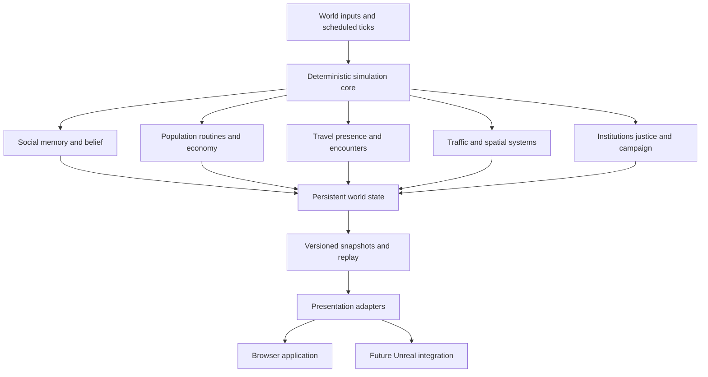

# Life Itself

**Life Itself** is a persistent, systemic open-world life simulation. **Simulated Reality Engine (SRE)** is its engine and technical code name. People remember, forget, talk, form reputations, experience trauma, navigate justice, make deals, and affect the lives around them. Everyday life—not just crime—is central to the simulation.

## Project status

- **Python reference engine:** broad simulation and cognitive-system coverage, including population execution, social belief, memory, institutions, routines, economy, and world-event systems.
- **Portable C++20 core:** deterministic runtime, dual clocks, world persistence, spatial/sensory systems, traffic coordination, route planning, campaign continuity, evidence provenance, and decision history.
- **Web application:** React, TypeScript, and Vite foundation with simulation-facing contracts and an API adapter boundary.
- **Unreal Engine:** presentation, animation, physics, assets, and runtime integration are not yet implemented.
- **Playable vertical slice:** the simulation systems are not yet connected into a finished player-facing crime-to-investigation loop. The browser app is a foundation, not yet an authoritative live simulation client.

See [the production implementation status](docs/PRODUCTION-IMPLEMENTATION-STATUS.md) for the current boundary between implemented systems and remaining work.

## Architecture

The simulation domain remains engine-independent. Python is the broad reference implementation; C++20 provides a portable native core. Hosts submit validated commands and consume immutable state snapshots. Unreal and browser presentation layers must not own or invent authoritative simulation state.



## Getting started

### Python reference engine

Requirements: Python 3.10+.

```bash
python -m pip install pytest
python -m pytest -q
```

### Portable C++ core

Requirements: C++20 and CMake 3.20+.

```bash
cmake -S cpp -B build
cmake --build build
ctest --test-dir build --output-on-failure
```

### Browser application

Requirements: Node.js 22+ and npm.

```bash
npm install
npm run dev
```

Create and preview a production build:

```bash
npm run build
npm run preview
```

The browser contracts are defined in `src/types/domain-contracts.ts`. The API adapter uses `VITE_SIMULATION_API_URL`; endpoint and streaming behavior are documented in [the simulation HTTP API guide](docs/SIMULATION-HTTP-API.md). The UI does not become authoritative until connected to a running simulation API.

## Key systems

- **Atomic world ticks:** travel, physical presence, confirmed encounters, and social processing execute in an ordered transaction with rollback and replay protection. See [the world tick pipeline](docs/WORLD-TICK-PIPELINE.md).
- **Population execution:** deterministic LOD scheduling, subsystem budgets, checkpoint participants, rollback, and action-linked household/economic effects. See [the population execution loop](docs/POPULATION-EXECUTION-LOOP.md).
- **Spatial and traffic simulation:** deterministic spatial indexing, perception, lane capacity, intersection conflict zones, collision avoidance, route planning, lease renewal, and occupancy-preserving deadlock proposals. See [durable traffic recovery](docs/DURABLE-TRAFFIC-RECOVERY.md).
- **Information provenance:** claims retain source lineage through NPC-to-NPC relays; repeated retellings do not become independent evidence. Belief revisions and moral decision records retain their evidence context. See [information provenance](docs/INFORMATION-PROVENANCE.md).
- **Campaign continuity:** immutable archived timelines, ghost influence, and cross-life campaign knowledge. See [campaign life continuity](docs/CROSS-LIFE-CAMPAIGN-KNOWLEDGE.md).

## Visualizer and product naming

- **GitHub Pages visualizer:** [michaelkage.github.io/Life-Itself](https://michaelkage.github.io/Life-Itself/)
- **Game/product:** Life Itself
- **Engine/code name:** Simulated Reality Engine (SRE)
- **Python package and C++ namespace:** `simreality`
- **Repository:** [michaelkage/Life-Itself](https://github.com/michaelkage/Life-Itself)

## Contributing and implementation history

Use the focused architecture guides under `docs/` for subsystem contracts and invariants. Historical implementation notes and the former running README changelog are preserved in [CHANGELOG.md](CHANGELOG.md).
